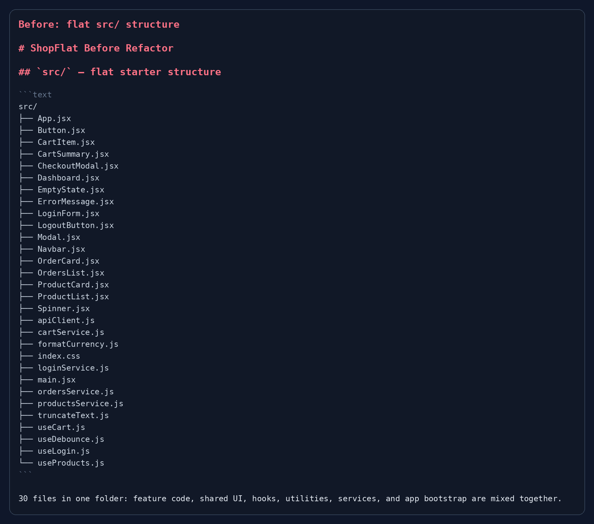
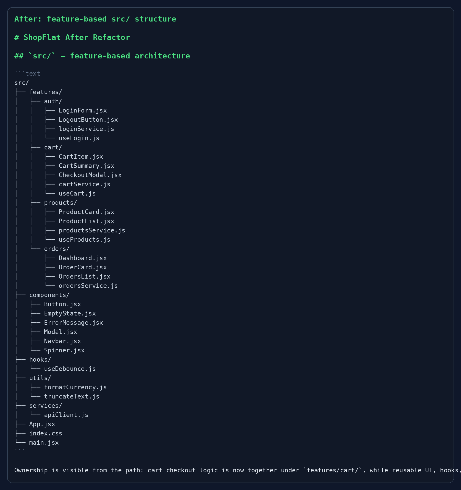

# ShopFlat — Organize the Chaos Challenge

ShopFlat is a React e-commerce application covering authentication, product discovery, cart checkout, and order history. This submission transforms the original flat `src/` directory into a feature-based architecture without changing the application's behavior.

## Completed Refactor

Feature-owned code now lives under `src/features/`:

- `features/auth/` contains login and logout UI, the authentication service, and `useLogin`.
- `features/products/` contains catalog UI, the product service, and `useProducts`.
- `features/cart/` contains cart UI, checkout UI, cart persistence, and `useCart`.
- `features/orders/` contains the dashboard, order-history UI, and the orders service.

Reusable presentation components are in `src/components/`, the feature-neutral debounce hook is in `src/hooks/`, pure formatting helpers are in `src/utils/`, and the shared mock API client is in `src/services/`. The application shell remains in `src/App.jsx`, `src/main.jsx`, and `src/index.css`.

The full mapping, folder rules, decision tree, new-feature guide, and before-versus-after explanation are documented in [`STRUCTURE.md`](./STRUCTURE.md).

## Before and After Evidence

The original flat structure and the final feature-based tree are included as screenshots for review:





## Features

- **Auth:** Log in with any email and the password `pass123`.
- **Products:** Browse and search the curated home-goods catalog.
- **Cart:** Add products, adjust quantities, remove products, and complete the simulated checkout flow.
- **Orders:** View the simulated order history and refresh the list.

## Tech Stack

- React 18
- Vite
- Tailwind CSS
- React Router v6
- Lucide React icons

## Getting Started

```bash
npm install
npm run dev
```

To create a production bundle:

```bash
npm run build
```

The production build was verified successfully with Vite after the refactor; the output is written to `dist/`.

## Live Deployment

The app is configured for GitHub Pages at [https://syedtalhas121-kalvium.github.io/Project-Engineering-ShopFlat/](https://syedtalhas121-kalvium.github.io/Project-Engineering-ShopFlat/). The repository's Pages workflow builds the Vite app on pushes to `main`.
